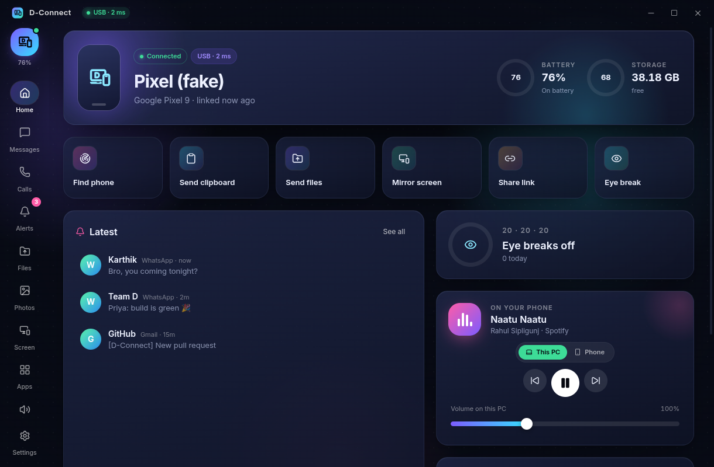
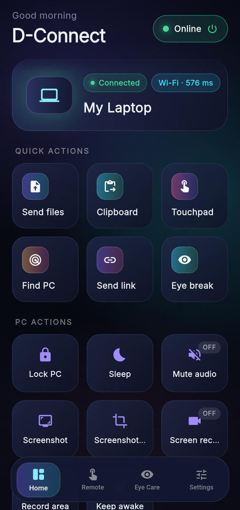

# Installing D-Connect

<p align="center">


</p>

D-Connect has two parts:

- an app for your **PC** (Linux or Windows), and
- an app for your **Android phone**.

Install both, then pair them once by scanning a QR code.

Download the files from the **Assets** list under this release:

| File | For |
|---|---|
| `D-Connect-<version>-android.apk` | Android phone (Android 8 or newer) |
| `D-Connect-<version>-android.aab` | Google Play upload only (not installable on a phone) |
| `d-connect_<version>_amd64.deb` | Ubuntu, Debian, Linux Mint, Pop!_OS |
| `D-Connect-<version>-linux-x86_64.AppImage` | Any other 64-bit Linux (no install needed) |
| `D-Connect-<version>-windows-setup.exe` | Windows 10 / 11 (64-bit) |

---

## Android phone (.apk)

1. Copy `D-Connect-<version>-android.apk` to the phone, or download it on the phone.
2. Open it. If Android asks, allow **Install unknown apps** for your browser or file manager.
3. Tap **Install**. If Play Protect warns about an unknown app, tap **More details → Install anyway**. The app isn't on the Play Store, which is why it warns.
4. If an older D-Connect from another build is already on the phone, Android may say *"App not installed"* or *"package conflicts"*. Uninstall the old one first, then install again.
5. Open D-Connect and allow the permissions it asks for.

**Optional extras on the phone (D-Connect → Settings):**

- **Screen control**: lets the PC tap and type while mirroring, and lets it move calls to the PC. If Android says *"Restricted setting"*, go to **App info → ⋮ → Allow restricted settings** first.
- **Work when locked** (OnePlus, Oppo, Realme, Xiaomi, Vivo): **App info → Battery usage → Allow background activity**. Without it the phone freezes D-Connect about a minute after the screen locks, and calls and texts stop showing on the PC.

---

## Linux: .deb (Ubuntu / Debian / Mint)

**From the desktop:** double-click `d-connect_<version>_amd64.deb` and click **Install**.

**From a terminal** (in the folder you downloaded it to):

```bash
sudo apt install ./d-connect_<version>_amd64.deb
```

Then open **D-Connect** from your app menu.

**To remove it:**

```bash
sudo apt remove d-connect
```

---

## Linux: AppImage (any distro)

```bash
chmod +x D-Connect-<version>-linux-x86_64.AppImage
./D-Connect-<version>-linux-x86_64.AppImage
```

If it says *"AppImages require FUSE"*, run `sudo apt install libfuse2` once (on Ubuntu 22.04 and newer).

---

## Windows (.exe)

1. Run `D-Connect-<version>-windows-setup.exe`.
2. If **Windows protected your PC** appears, click **More info → Run anyway**. The installer isn't code-signed, so Windows doesn't recognise it yet.
3. Choose where to install and finish the setup.
4. When Windows Firewall asks, allow D-Connect on **Private networks**. The phone connects to the PC over your Wi-Fi.

**To remove it:** Settings → Apps → D-Connect → Uninstall.

> On Windows, taking phone calls through the PC's speakers and mic over Bluetooth isn't supported yet. You can still see, answer and decline calls from the PC; the audio stays on the phone. Windows is less tested than Linux, so some features may behave differently there.

---

## Pair the phone with the PC

1. Make sure the phone and PC are on the **same Wi-Fi**, or connect them with a USB cable that has USB debugging on.
2. Open D-Connect on the PC. It shows a **QR code**.
3. On the phone, open D-Connect → **Scan QR code** and point it at the code on the PC.
4. Done. Next time they find each other on their own.

**Calls through the PC (Linux):** open **Settings → Take calls on this PC** on the PC and follow the three steps. You do this once. It pairs the phone over Bluetooth and sets up the call audio.

## Troubleshooting

- **Phone not found:** check both are on the same Wi-Fi, and that the Wi-Fi isn't a guest network that blocks devices from seeing each other. USB with debugging on works too.
- **Texts and calls stop when the phone is locked:** turn on **Work when locked** (see above).
- **Calls stay on the phone:** turn on **Screen control** on the phone.
